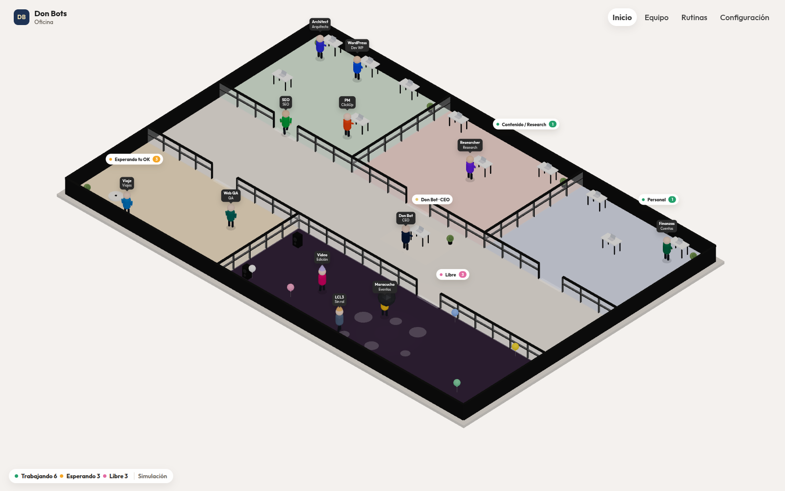
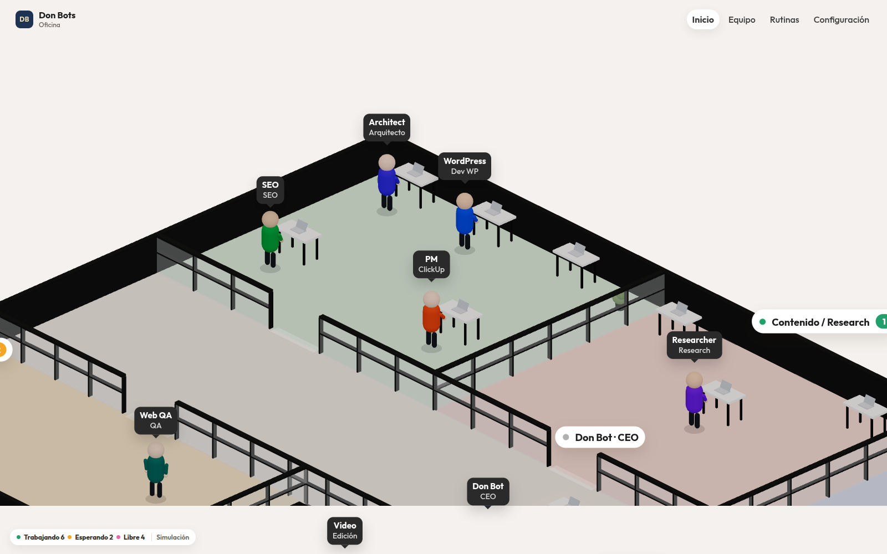
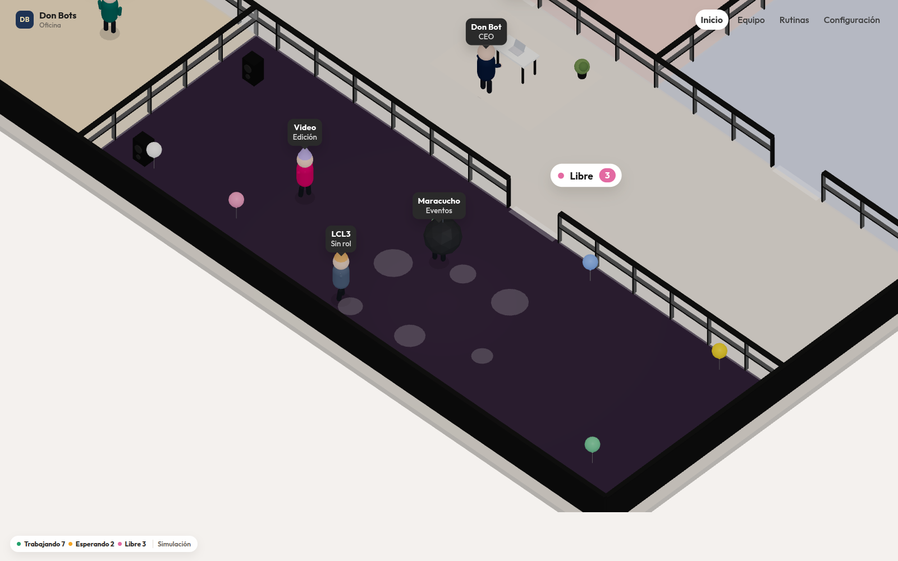
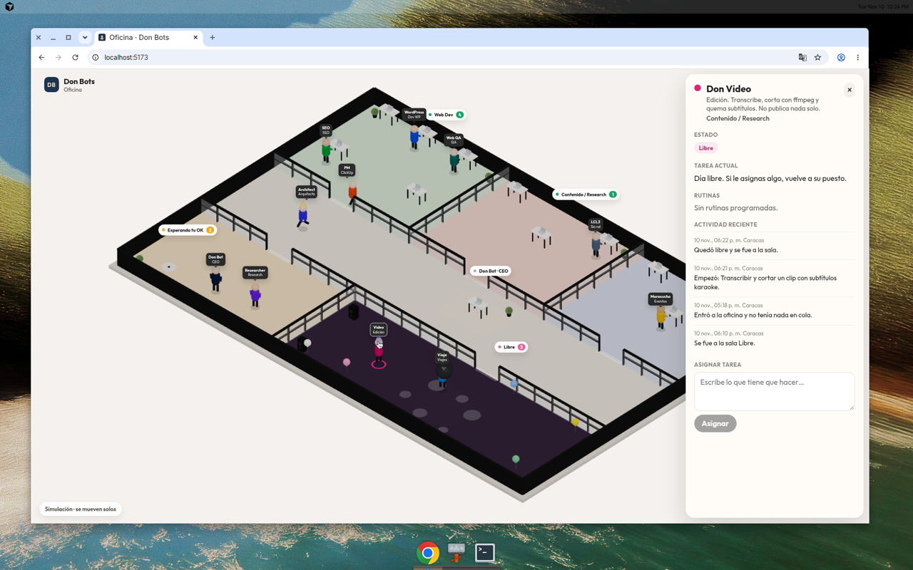

# Oficina de Don Bots

Prototipo 3D de la oficina de los agentes de Vessel. Salas por área (Web Dev, Personal, Contenido / Research), el escritorio de Don Bot en el centro, y tres salas de estado: **Trabajando**, **Esperando tu OK** y **Libre** (la sala de fiesta). Cada bot camina a la sala que le toca cuando cambia su estado.

Hoy no hay una fuente en vivo. Grok Bot no publica el estado de los bots, y Hermes en el VPS todavía no está conectado. La oficina corre con una simulación para poder verla. El plan para enchufarla está en [`docs/HERMES.md`](docs/HERMES.md).

Los nombres, roles y rutinas salen de `bots/<bot>/HANDOFF.md` (10 nov 2026) y viven en `src/data/bots.json`. No hay correos, teléfonos ni tokens. `npm run check` falla si aparece un bot nuevo en `bots/` que no esté en ese JSON, o si alguien mete un correo o un número largo en `office/`.

## Correrlo

Hace falta Node 20+.

```bash
cd office
npm install
npm run dev
```

Abre la URL que imprime Vite (por defecto `http://localhost:5173`). Los bots cambian de estado solos cada pocos segundos. Un click en un avatar abre la ficha: estado, tarea, rutinas, actividad y **Asignar tarea** (por ahora solo dentro de la simulación).

```bash
npm run build
```

Eso deja la oficina estática en `office/dist/`.

## Fuente de datos

`VITE_AGENT_SOURCE` elige el adaptador (`src/sources/`):

| Valor | Qué hace |
|---|---|
| `mock` (default) | `MockSource`. Inventa cambios de estado y tareas de ejemplo. |
| `hermes` | `HermesSource`. Stub: habla con un puente en el VPS que todavía hay que escribir. Sin `VITE_HERMES_BASE_URL` la pantalla dice que falta configurarlo. |

Copia `.env.example` a `.env.local` si quieres cambiarlo. Vite solo expone variables que empiezan por `VITE_`. No pongas llaves ahí: quedan dentro del bundle.

## Publicar en el VPS (archivos estáticos)

```bash
cd office
npm install
npm run build
# sube el contenido de dist/, no la carpeta office entera
rsync -av --delete dist/ usuario@tu-vps:/var/www/oficina/
```

Ejemplo de nginx. Una sola página, sin rutas internas:

```nginx
server {
    listen 80;
    server_name oficina.internal;
    root /var/www/oficina;
    location / {
        try_files $uri $uri/ /index.html;
    }
}
```

`base` de Vite está en `./`, así que también sirve bajo un subpath si el `root` apunta a esa carpeta.

La oficina no trae login. La idea es no dejarla en internet abierto:

- **Tailscale.** Sirve la carpeta solo en tu tailnet. Los flags cambian entre versiones; en el VPS corre `tailscale serve --help` y publícalo ahí. Así entras desde el teléfono sin abrir un puerto.
- Si hace falta una clave además de la tailnet, pon basic auth en nginx o Caddy. No la hornees en el JavaScript.

Eso alcanza para ver el prototipo. Para que los estados sean reales hace falta el puente de [`docs/HERMES.md`](docs/HERMES.md): la página estática no puede leer los archivos de Hermes en el disco del VPS.

## Qué se ve

- **Trabajando:** cada bot está en la sala de su área. Don Bot se queda en el escritorio del centro. La pastilla de arriba suma a todos los que están trabajando.
- **Esperando tu OK:** sala de espera. Algo quedó listo y no sigue sin aprobación.
- **Libre:** sala violeta, bola de disco y sombreros. Bailan hasta que les asignas una tarea: ahí caminan de vuelta a su puesto.

La copia de la interfaz está en español. En el teléfono la ficha baja como una hoja y las pastillas se achican. El piso se encuadra solo al tamaño de la ventana. `#web` y `#libre` acercan la cámara a esa sala.

## Cómo se ve








